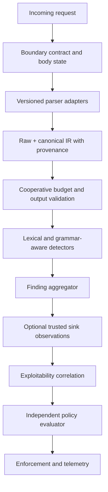

# EthioShield Detection Engine v2 Architecture Review

**Repository:** `etshiled`  
**Review date:** 2026-10-31  
**Status:** Design only; no implementation authorized by this document  
**Current SDK:** `0.1.0-alpha.0`

## 1. Executive decision

EthioShield currently provides bounded request inspection, heuristic indicators
for SQL injection, NoSQL operators, XSS, and path traversal, independent policy
evaluation, optional rate limiting/correlation, and manually invoked
instrumentation interfaces.

It does **not** currently provide verified sink-level exploitability detection,
automatic runtime sink instrumentation, authentication, authorization, SSRF
enforcement, command-injection enforcement, or reliable prevention of injection
attacks. The existing detectors must remain documented as indicators and risk
signals.

The revised implementation order is:

1. Contract and evidence baseline
2. Enforcement correctness and body-state handling
3. Canonicalization and parser provenance
4. Structured detector adapters
5. Sink observation and exploitability correlation
6. Stateful behavioral correlation hardening
7. Operational qualification

Enforcement correctness is deliberately earlier than new detector coverage.

## 2. Evidence classification

### 2.1 Verified repository defects

These are supported by direct inspection of the current source:

1. `DetectionBudget.maxDurationMs` is declared in
   `packages/security-contracts/src/detection.ts`, but
   `packages/sdk-node/src/detection/engine.ts` does not enforce it.
2. `packages/sdk-node/src/express.ts` can run before a body parser and inspect an
   absent `request.body`; block mode can therefore allow an uninspected body to
   reach the application.
3. Route exclusions call `next()` before detection and telemetry.
4. The four detectors return request-input indicators; none verifies that input
   reached a SQL, HTML, filesystem, command, or outbound HTTP sink.
5. Instrumentation observers are opt-in host calls, not automatic runtime
   instrumentation.
6. Normalization performs one percent-decoding pass without transformation
   provenance or ambiguity status.

### 2.2 Architectural hypotheses requiring reproduction

These are deployment-dependent and must not be reported as confirmed
vulnerabilities without an integration test:

- A downstream framework may decode a value again.
- A proxy and application parser may disagree on duplicate keys or path
  canonicalization.
- A custom plugin may perform excessive synchronous work.
- A host identity callback may return delimiter-bearing values.

### 2.3 Deferred enhancements

XML/XXE, YAML, multipart parsing, SSRF detection, command-injection indicators,
template injection indicators, automatic route inventory, and distributed
counter adapters are future work. Their interfaces must not be described as
implemented protection until integrated and tested.

## 3. Execution-budget contract

`maxDurationMs` is a **cooperative execution budget**, not a hard timeout.

The engine may check elapsed time at defined checkpoints and stop scheduling
additional detector work. It must return an explicit `budget_exceeded` or
`inconclusive` result, never a clean result.

The engine cannot interrupt a synchronous JavaScript detector already executing
on the event loop. `Promise.race`, `setTimeout`, and `AbortSignal` do not provide
hard interruption. A hard timeout requires an isolation mechanism such as a
worker thread or separate process, with bounded messages, termination behavior,
startup cost, and lifecycle management. That mechanism is deferred until
approved by a separate design review.

Until isolation exists:

- built-in detectors must be bounded and checkpoint cooperatively;
- plugin contracts must state that synchronous work is trusted/cooperative;
- detector errors and budget exhaustion are explicit non-clean outcomes;
- performance tests must measure, but must not claim, hard interruption.

## 4. Canonicalization contract

Every inspected value in the v2 intermediate representation must retain:

- `raw`: bounded input at the selected trust boundary;
- `canonical`: the representation supplied to a detector;
- `decodeDepth`: number of permitted decoding transformations;
- ordered transformation provenance;
- `parserId` and `parserVersion`;
- duplicate-key status and parser duplicate semantics;
- `truncated`, `malformed`, and `ambiguous` flags;
- source component, path, and depth.

Canonicalization is not “decode until stable.” Each boundary declares an
allowlisted, bounded transformation pipeline and maximum decode depth. If a
second representation could change security meaning, the result is
`ambiguous`/`inconclusive`, not silently safe.

HTML entity decoding, SQL literal interpretation, and filesystem resolution are
context-specific. They must not be applied globally to every request value.
The application parser, detector parser, and sink integration must declare
compatible parser contracts. If consistency cannot be established, enforcement
uses the configured fail-closed behavior for that component.

## 5. Detection versus exploitability

The engine must use separate types and policy paths for:

- **Detection finding:** an input, behavioral, or contextual indicator with
  evidence, confidence band, and limitations.
- **Sink observation:** a host-provided observation that a request or value
  reached a sensitive operation.
- **Verified exploitability assessment:** a correlation result requiring both
  sufficient request evidence and a trusted sink observation.

A request finding alone is not proof of SQL injection, XSS, SSRF, command
injection, or path traversal. A sink observation alone is not malicious without
request or policy context. Automatic blocking requires explicit policy mapping
and conservative handling of ambiguous findings.

## 6. Target architecture

No automatic monkey-patching is part of this architecture. Future integrations
must be explicit adapters for supported database, HTTP, filesystem, command,
template, and authorization libraries.

## 7. Revised milestone plan

Each milestone is independently reviewable. The listed files are proposed
changes, not claims that they already exist. Rollback means reverting that
milestone's commit while retaining prior validated milestones.

### M0 — Contract and evidence baseline

**Files**

- `packages/security-contracts/src/detection.ts`
- `packages/sdk-node/src/detection/types.ts`
- `packages/sdk-node/src/detection/engine.ts`
- `packages/sdk-node/test/detection.test.ts`
- `packages/sdk-node/test/parser-differential.test.ts`

**Changes:** Add explicit `complete`, `error`, and `inconclusive` result states,
budget outcomes, provenance/evidence types, plugin-output validation, and
cooperative-budget documentation.

**Adversarial tests:** Slow synchronous plugin, invalid findings, oversized
output, checkpoint behavior, and detector exceptions.

**Compatibility risks:** External plugins may assume numeric confidence or that
every non-error result is complete.

**Acceptance criteria:** Detector failure, budget exhaustion, and invalid plugin
output cannot become a clean result. Existing valid fixtures retain findings.

**Rollback:** Revert the contract/engine commit and retain the current v1
compatibility adapter.

### M1 — Enforcement correctness and body-state handling

**Files**

- `packages/sdk-node/src/express.ts`
- `packages/sdk-node/src/detection/types.ts`
- `packages/sdk-node/src/detection/parsers/`
- `packages/sdk-node/test/express.test.ts`
- `packages/sdk-node/test/parser-differential.test.ts`
- `packages/sdk-node/README.md`

**Changes:** Define `absent`, `parsed`, `malformed`, `unavailable`, and
`streaming` body states. Require parser ordering or an explicit safe
integration. In enforce mode, fail closed for relevant unavailable bodies.
Make monitor behavior and policy/runtime mode conflicts explicit.

Route exclusions must produce an explicit exclusion decision and telemetry
record, require method-specific matching, and be treated as deliberate policy
exceptions rather than silent bypasses.

**Adversarial tests:** Middleware before/after JSON, URL-encoded, multipart, and
stream parsers; malformed bodies; excluded malicious routes; policy enforce plus
runtime monitor; telemetry failure; detector failure; consumed streams.

**Compatibility risks:** Applications relying on body-less block-mode requests
passing through may receive a controlled rejection. Exclusions will generate
events.

**Acceptance criteria:** No relevant unparsed body reaches the application in
enforce mode. Every exclusion is observable. Block-mode failures are
deterministic. Telemetry cannot alter a decision.

**Rollback:** Restore previous middleware behavior behind an explicit
compatibility flag without reverting the new contract types.

### M2 — Canonicalization and parser provenance

**Files**

- `packages/sdk-node/src/detection/normalization.ts`
- `packages/sdk-node/src/detection/normalization/v1.ts`
- `packages/sdk-node/src/detection/parsers/`
- `packages/sdk-node/src/detection/types.ts`
- `packages/sdk-node/test/parser-differential.test.ts`
- `packages/sdk-node/test/detection.test.ts`

**Changes:** Add raw/canonical value records, bounded allowlisted
transformations, decode depth, parser identity/version, duplicate-key status,
and ambiguity reporting. Do not globally decode HTML entities, SQL literals, or
filesystem paths.

**Adversarial tests:** One- and two-level encodings, mixed-case escapes,
malformed encodings, invalid UTF-8, Unicode normalization, HTML entities,
duplicate query/JSON keys, parser ordering, and proxy/application path
differences.

**Compatibility risks:** Findings may change where current detectors depend on
lowercasing or implicit object-key traversal.

**Acceptance criteria:** Every finding identifies canonicalization/provenance
state. Ambiguous values are not clean. Raw secrets remain excluded from events.

**Rollback:** Retain the v1 normalizer behind the existing adapter and disable
v2 parser routing.

### M3 — Structured detector adapters

**Files**

- `packages/sdk-node/src/detection/sql-injection.ts`
- `packages/sdk-node/src/detection/nosql-injection.ts`
- `packages/sdk-node/src/detection/xss.ts`
- `packages/sdk-node/src/detection/path-traversal.ts`
- `packages/sdk-node/src/detection/`
- `packages/sdk-node/test/detection.test.ts`

**Changes:** Make detectors consume the structured intermediate representation.
Use bounded token/grammar adapters and preserve detector-specific limitations
and confidence bands. Do not claim SQLi/XSS prevention from request matching.

**Adversarial tests:** Comment and quote variants, nested operators, duplicate
parameters, entity/scheme variants, mixed separators, double-encoding
ambiguity, benign technical text, and resource-exhaustion inputs.

**Compatibility risks:** Detector ordering and rule IDs must remain stable;
false-positive rates may change.

**Acceptance criteria:** Findings are bounded, validated, deduplicated, and
classified as indicators unless sink correlation exists.

**Rollback:** Retain current detector adapters and disable v2 plugins
independently.

### M4 — Sink observation and exploitability correlation

**Files**

- `packages/sdk-node/src/instrumentation.ts`
- `packages/sdk-node/src/detection/types.ts`
- `packages/sdk-node/src/express.ts`
- `packages/sdk-node/test/instrumentation.test.ts`
- `packages/sdk-node/test/express.test.ts`

**Changes:** Define explicit host-invoked adapters for SQL, outbound HTTP,
filesystem, command, template/output, and authorization observations. Add
bounded observer results and correlation IDs. Do not monkey-patch global APIs.

**Adversarial tests:** Observer timeout/throw, mismatched correlation IDs,
sanitized sink metadata, request-only finding versus finding-plus-sink, and
observer outage behavior.

**Compatibility risks:** Hosts must integrate adapters. Constructing the
instrumentation hub alone must provide no implied runtime protection.

**Acceptance criteria:** Sink findings are distinguishable from request
indicators. Observer failures cannot create a false clean result. Telemetry
contains no raw secrets, queries, bodies, or command arguments.

**Rollback:** Disable adapters independently and retain request-only policy.

### M5 — Stateful behavioral correlation

**Files**

- `packages/sdk-node/src/correlation.ts`
- `packages/sdk-node/src/rate-limit/`
- `packages/security-contracts/src/index.ts`
- `packages/sdk-node/test/correlation.test.ts`
- `packages/sdk-node/test/rate-limit.test.ts`

**Changes:** Use structured/length-prefixed keys, explicit TTL/cardinality
policies, route/account/subject correlation, and documented shared-store
requirements. Keep IP as one signal, not identity.

**Adversarial tests:** Delimiter-bearing identities, 2,000 users behind one IP,
300 rotating IPs against one account, IPv6 rotation, concurrency, store outage,
expiry, and cardinality exhaustion.

**Compatibility risks:** Existing counters may not match after key encoding;
distributed deployments require a compatible atomic store.

**Acceptance criteria:** Keys are unambiguous. Outage behavior is deterministic.
Local protection remains available without cloud intelligence.

**Rollback:** Provide a versioned key strategy and revert only with an explicit
migration setting.

### M6 — Operational qualification

**Files**

- `packages/sdk-node/test/operational-hardening.test.ts`
- `packages/sdk-node/test/express.test.ts`
- `scripts/package-exports.test.mjs`
- `scripts/check-artifacts.mjs`
- `README.md`
- `packages/sdk-node/README.md`

**Changes:** Add measured performance/memory regression tests, package/export
checks, rollout documentation, and release blockers for incomplete parser,
enforcement, or sink integration.

**Adversarial tests:** Sustained bounded inputs, repeated oversized requests,
plugin budget overruns, package boundary inspection, and staged monitor-to-block
rollout.

**Compatibility risks:** Release gates may reject deployments that passed only
generic tests.

**Acceptance criteria:** Required checks pass; unsupported vulnerability classes
are explicitly labeled; no production claim depends on coverage percentage alone.

**Rollback:** Revert only release-gate/documentation changes; never weaken
runtime enforcement silently.

## 8. Current capability boundary

| Capability | Current status |
|---|---|
| SQL, NoSQL, XSS, path traversal indicators | Implemented, tested, heuristic |
| Canonicalization provenance | Not implemented |
| Hard synchronous timeout | Not implemented and not claimable |
| Body-state enforcement | Incomplete; requires M1 |
| Sink-level exploitability | Not implemented |
| Manual instrumentation interfaces | Implemented |
| Automatic runtime instrumentation | Not implemented |
| Rate limiting/correlation | Implemented when configured; shared-store dependent |
| Authentication/authorization | Host-application responsibility |
| SSRF, command injection, XXE, CSRF, webhook verification | Not implemented |

No milestone is complete until its source changes, adversarial tests,
compatibility risks, acceptance criteria, and rollback path have been reviewed.
